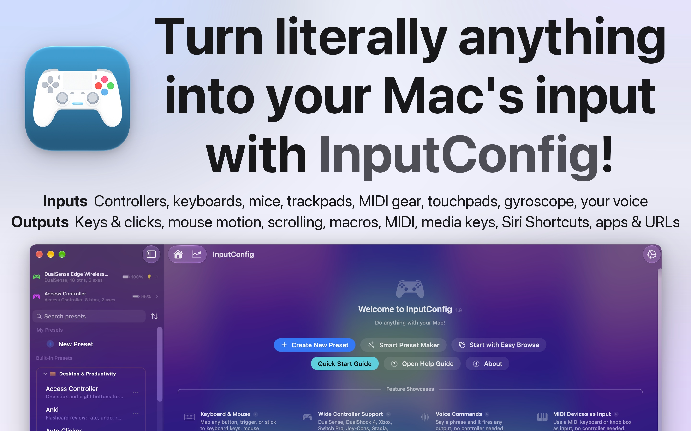
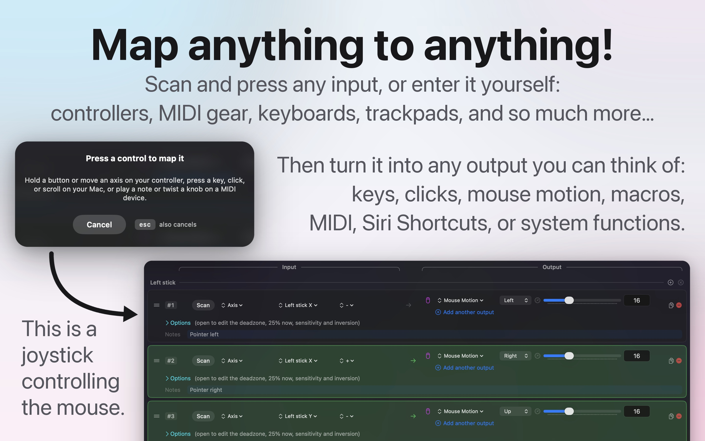
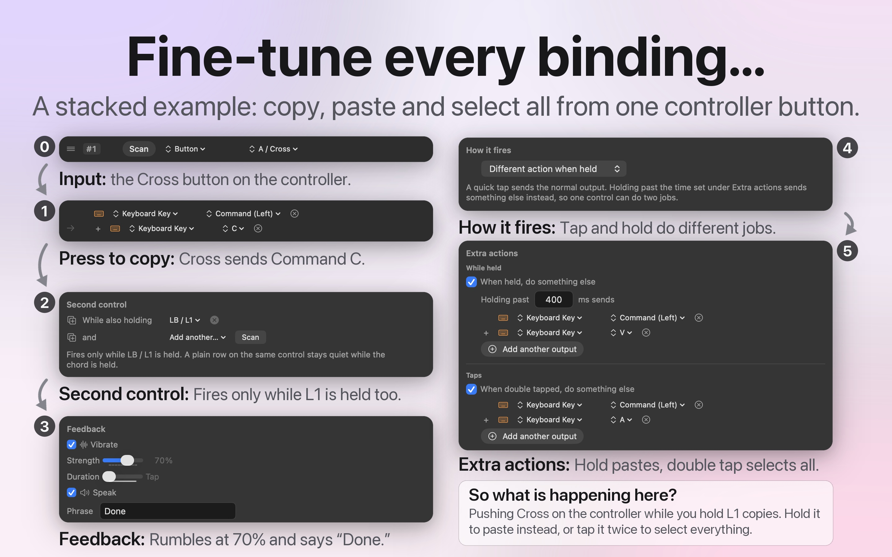
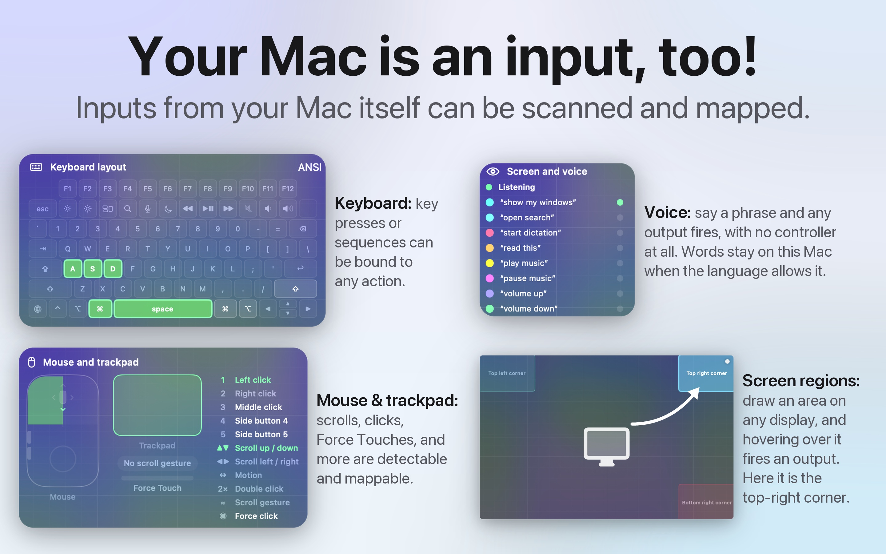
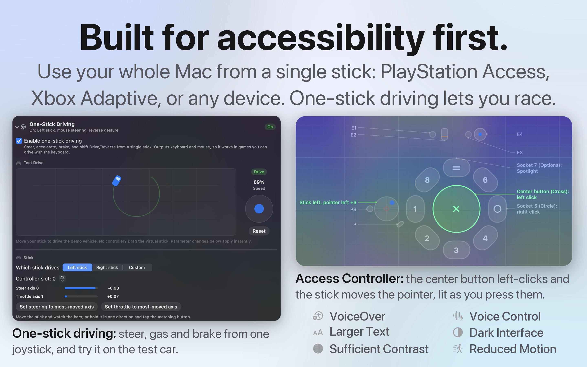
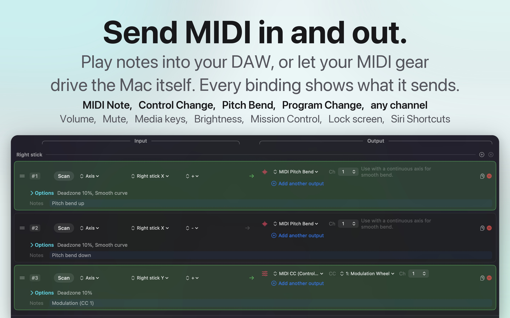
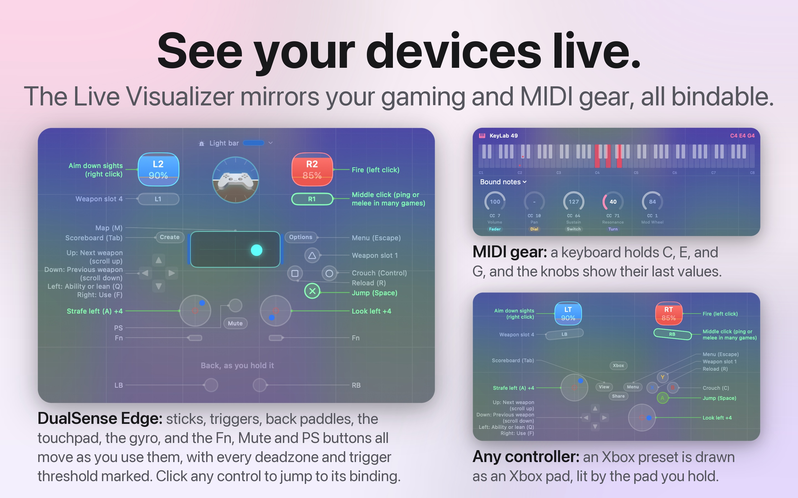
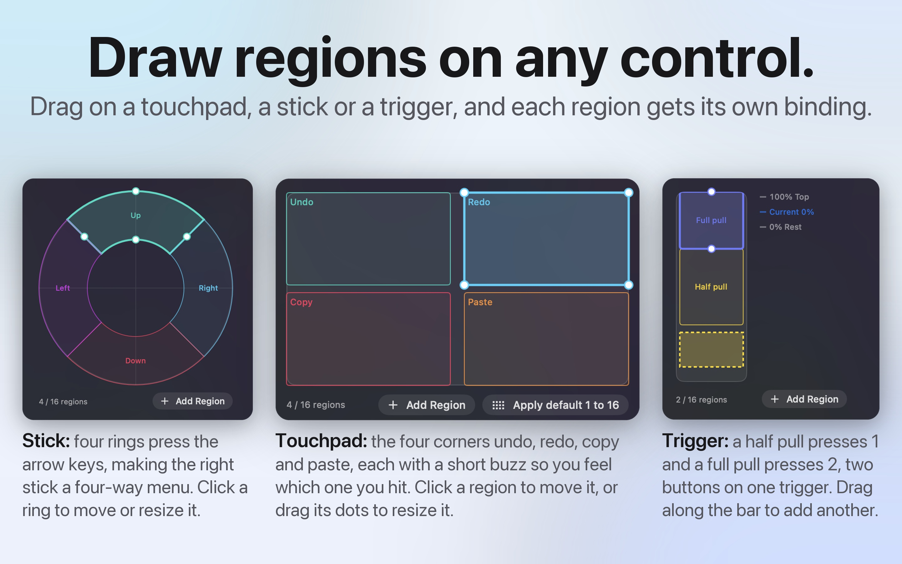
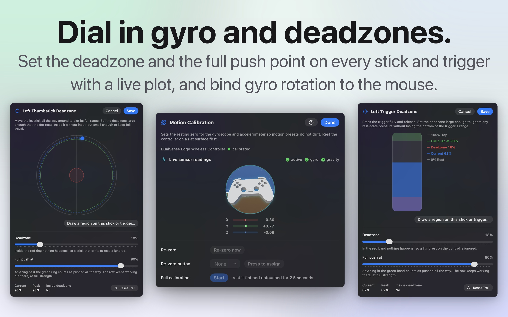
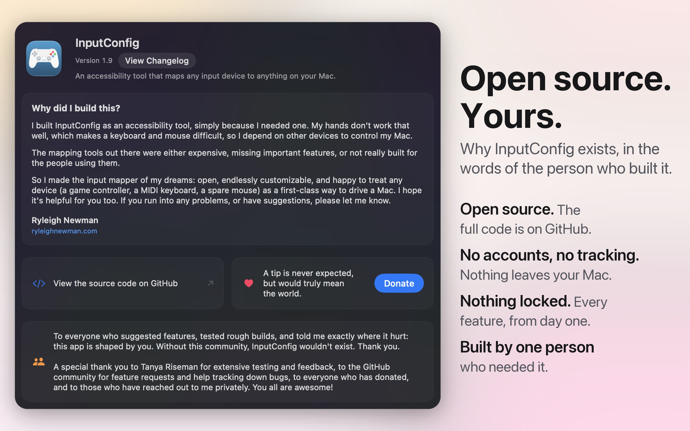

# InputConfig: free controller mapper for Mac



InputConfig is a free, open-source controller mapper for macOS. Map any PS5, Xbox or
Switch controller to keyboard keys and mouse movement, use a controller as a mouse,
run your Mac from a MIDI knob box, play games that never supported controllers, or
replace a keyboard entirely if using one is difficult. It works in every app, not
only games.

Works with PS5 DualSense and DualSense Edge, PS4 DualShock 4, Xbox Wireless, Series
and Elite, Switch Pro, Switch 2 and Joy-Con, 8BitDo Pro 2 and Ultimate 2C, the PlayStation Access Controller, the
Xbox Adaptive Controller, MIDI keyboards and pad controllers, and any HID-compatible
gamepad. No drivers, no subscription, no account.

Website and documentation: [inputconfig.com](https://inputconfig.com), with
[help for every feature](https://inputconfig.com/help/), [guides](https://inputconfig.com/guides/),
and [ready-made presets for 450+ games and apps](https://inputconfig.com/presets/).

<a href="https://apps.apple.com/us/app/inputconfig/id6777759147?pt=128760092&amp;ct=github&amp;mt=12"></a>

Or install it with Homebrew:

```
brew install --cask ryleighnewman/inputconfig/inputconfig
```

It is the same app, signed with a Developer ID and notarized. The tip jar is empty outside the App Store, and the two copies share one preset library, so keep one or the other in Applications.

## Overview

Plug in your device, pick a preset, and go. Or build your own from scratch: every
button, trigger, stick, key, knob, and pad can send keys, clicks, mouse motion,
scroll, macros, MIDI, spoken phrases, or a system function like volume, brightness,
or a Siri Shortcut.

It is not just for game controllers. Your Mac keyboard, a second keyboard, extra
mouse buttons, the trackpad (including Force Touch pressure), regions of the screen,
and full MIDI gear all work as inputs too.

## What's new in 1.9

- Macro recorder: click Record steps, use any app, and your keys, clicks, drags, scrolling and timing become steps
- Macro steps can type text, scroll, run a system action, wait, move the pointer, or wait for a color or words on screen
- Macro playback: Play once tries a macro from the editor, and a macro can set its speed, add random timing, or run until pressed again
- Macro text: read, edit, copy and paste any macro as plain lines such as cmd c, wait 300, type "hello"
- Voice phrase, a new input: say a phrase and its row fires, through the microphone you choose, with a Voice Commands preset ready to try
- Screen color and Screen text, new inputs: a row fires from the color at a spot on screen, or from words as they appear
- Button sequence and Key sequence, new inputs: a row fires when buttons or keys come in a set order, such as Down, Down, A
- Block the key's own action: W mapped to Up Arrow no longer also types W
- Keyboard and mouse rows can wait for a second control, such as Left Command with a middle click
- New pointer outputs: Mouse Motion Step, Precision While Held, Save Pointer Spot, Return Pointer to Spot and Pointer to Next Screen
- Utilities, set per preset: the speed and direction of your mouse, trackpad and wheel, smooth scrolling, steadying for a shaky hand, the light bar, and controller disconnect and reconnect
- Only work in these apps: a preset that lists apps holds its outputs back while any other app is in front
- Activate with controller: a preset starts when a controller it lists connects, and steps aside when it leaves
- Access controller: fit your own caps and tags, and the visualizer draws them for each profile
- 25 more controllers drawn in the Live Visualizer, including the 8BitDo Pro 3, Switch 2 Pro, Joy-Con 2, Backbone One, Razer Kishi V2, flight sticks and racing wheels
- Simple View in the View menu: big buttons for your favorite presets
- Much lighter on your Mac: a running preset uses less than half the CPU, and switching presets is nearly twice as fast
- Tap the Mac is no longer offered on macOS 27 in the App Store version
- Fixed crashes from damaged preset files and from unplugging a controller
- Keys and mouse buttons no longer stay held down if the app freezes
- Idle disconnect no longer drops a pad a game is using, and a pad that reconnects keeps its slot
- Fixed presets not opening from the sidebar on some Macs, and a hang at logout

Full release history in [CHANGELOG.md](CHANGELOG.md). This section tracks the latest release.

## A tour

Open InputConfig and everything it can do is on one screen. Controllers, keyboards,
mice, trackpads, and MIDI gear go in; keys, mouse, macros, MIDI, system functions,
and Siri Shortcuts come out. Forty-six presets ship with it, sorted into folders you
can name and color, and the Smart Preset Maker draws on a library of more than 450
games and apps.



Scanning maps any input the instant you touch it. No manual codes, no guesswork,
and it works for controllers, MIDI gear, and your Mac's own keyboard and trackpad.



One press can send a key, a click, a MIDI note, and a spoken phrase at once, then
repeat while held, send Return on a double tap, run a two-step macro, and rumble,
with every timing set right in the row.



Every key on the keyboard, every click, scroll gesture, and Force Touch on the
trackpad or mouse, any area of the screen, and a knock on the palm rest can all be
scanned and mapped like a controller button.



Drive your whole Mac from a single stick. One-stick driving steers, accelerates,
brakes, and shifts from one control, and it outputs keyboard and mouse, so it works
in games that never planned for it. Built with the PlayStation Access Controller
and other adaptive hardware in mind.



Play notes into your DAW through a virtual MIDI port, or let a MIDI keyboard or knob
box drive the Mac itself: volume, tracks, brightness, Mission Control, a Siri
Shortcut. Every binding shows exactly what it sends.



The Live Visualizer mirrors your controller and your MIDI gear in real time. Sticks,
triggers, keys, and knobs light up as you play, clicking any control jumps straight
to its binding, and Edit Layout rearranges the keyboard, mouse, touchpad and generic
maps; a drawn controller keeps its real layout.



Draw regions right in the editor: rings on a stick, bands along a trigger's pull, and
areas on a controller touchpad or the screen. Each region is a button of its own, and
the Live Visualizer lights it as you reach it.



Set the Deadzone and Full push at points on every stick and trigger and watch the row
follow live, so drift disappears and full travel stays. Bind gyroscope rotation to the mouse for
motion aim in any app, with live sensor readings and a resting-zero calibration.



No accounts, no tracking, no locked features. Built by one person who needed it.

## How it compares

| | InputConfig | Joystick Mapper | Gamepad Mapper | JoyMapper | ConMapper | ControllerKeys | Recontrol | Enjoyable | Karabiner-Elements |
|---|---|---|---|---|---|---|---|---|---|
| Cost | Free | Paid | Free, paid add-ons per controller | Free trial, then paid | Free, in-app purchases | Paid, 14-day trial | Free | Free | Free |
| Open source | Yes, MIT | No | No | No | No | Source available, noncommercial license | Not stated | Yes | Yes |
| Game controllers | Yes | Yes | Yes | Yes | Yes | Yes | Yes | Yes | No, keyboards only |
| MIDI keyboards and pads as input | Yes | No | No | No | No | No | No | No | No |
| Mac keyboard/mouse/trackpad as input | Yes | No | No | No | No | No | No | No | Keyboard only |
| DualSense Edge paddles and extras | Yes | No | No | Not stated | Not stated | Not stated | Not stated | No | No |
| System functions and Siri Shortcuts | Yes | No | System functions, paid add-on | No | Shortcuts and app launch | Yes | Media keys | No | Limited |
| Per-app preset switching | Yes | No | No | Yes | Yes | Yes | Not stated | No | Yes |
| Macros, turbo, tap and hold | Yes | Limited | Limited, paid add-on | Not stated | Not stated | Yes | Not stated | No | Limited |
| MIDI output | Yes | No | No | No | No | Trigger to CC | No | No | No |
| Gyroscope and motion | Yes | No | Not stated | Yes | Yes | Yes | Not stated | No | No |
| Light bar control | Yes | No | Not stated | Not stated | Not stated | Yes | Not stated | No | No |
| Still updated | Yes | No, last update 2019 | No, last update 2024 | Yes | Yes | Yes | Yes | No | Yes |
| Minimum macOS | 14 | 10.9 | 12 | 10.14 | 14 | 14.6 | 15.6 | Intel only | 13 |

Checked November 2026 against each app's own App Store listing or site. "Not stated" means the
app does not claim it, not that it cannot do it. Gamepad Companion is no longer on the Mac
App Store. Some of these have been around far longer than mine and are good tools. Check for
yourself before you switch.

Coming from Windows? JoyToKey, reWASD, DS4Windows, AntiMicroX and Xpadder do not run on a Mac.
InputConfig covers the same ground, and [inputconfig.com](https://inputconfig.com/questions/best-controller-mapper-for-mac)
compares every Mac option in one place.

## Everything it does

### Input sources

- Every button, trigger, joystick, and D-pad on any MFi or HID-compatible gamepad
- DualSense Edge extras: both back paddles, both FN buttons, and the mute button, over USB and Bluetooth
- Controller touchpads: cursor control, two-finger tracking, regions, and one-finger and two-finger taps
- Gyroscope, accelerometer, and absolute attitude on Sony controllers (DualSense, DualShock 4)
- MIDI notes and pads, CC knobs, sliders, and pedals, the pitch wheel, channel and polyphonic aftertouch, Program Change, and transport Start, Continue, and Stop, from any MIDI device over USB or Bluetooth
- Three knob modes for MIDI dials: Switch (fires past halfway), Dial (speed grows from center, like a stick), and Turn (a nudge per step of rotation, for knobs and for endless encoders set to absolute mode)
- Per-binding MIDI channel and device filters, so two keyboards stay independent
- Your Mac keyboard as an input: every key, including Shift, Control, Option, Command, Caps Lock, fn, and the brightness, media, and volume keys, on the built-in keyboard or any keyboard you connect (all keyboards read as one)
- Your mouse and trackpad as inputs: every button, double click, scroll in four directions, scroll gestures, Force Touch pressure, and Force Click
- Tap the Mac: knock on the palm rest and the MacBook's motion sensor fires any output, single to quintuple taps, with a live calibration plot (on macOS 27, in the Homebrew version)
- Screen regions: areas of any display that act as inputs while the pointer is inside them, per display or on every display
- Bluetooth headset and hearing aid buttons as media keys
- Switches, pedals, and sticks plugged into a PlayStation Access Controller or Xbox Adaptive Controller
- Stick regions as rings, trigger bands, and stick gestures such as pulling a stick back twice, each with its own bindings

### Outputs

- Keyboard keys, including full modifier combos (Cmd+Shift+3 and friends fire as real chords)
- Type whole words or phrases from a single press
- Mouse buttons, analog mouse motion, smooth scrolling, and single scroll steps
- Macro sequences with custom timing, chord steps that hold one key while tapping others, and interrupt-on-release
- MIDI out to your DAW through a virtual port: notes with velocity, CC, pitch bend, Program Change, and transport (start, stop, continue)
- Spoken phrases, in the system voice or any installed voice
- Haptic feedback with adjustable strength and duration
- App actions: switch presets, jump to a specific preset, pause and resume output, all from the controller

### System functions

- Volume up, volume down, and mute, in the same steps as the keyboard keys
- System volume as a fader: the Mac's level follows a knob's position 1-to-1, and only takes over once you actually move it
- Play/pause, next track, and previous track, as real media keys
- Screen brightness up and down
- Mission Control, Launchpad, Spotlight, lock screen, and the screenshot toolbar
- Run any Siri Shortcut by name, picked from a list of your installed Shortcuts, without stealing focus
- Open any app or any URL, from https links to app schemes

### Per-binding control

- Toggle mode: press once to latch, press again to release
- Turbo with an adjustable rate, and repeat counts with custom delays
- Hold actions and double-tap actions, each with their own outputs and timing windows
- Chords: a row can require up to three controls held together, each chosen from the menu or scanned
- Deadzone and Full push at on every stick and trigger, shown live in the row and in a full calibrator
- Axis inversion and three sensitivity curves: linear, smooth, aggressive
- Variable sensitivity: trigger pressure and stick depth scale the output speed
- Stacked outputs: one input firing several outputs in parallel
- A note field on every binding, so a preset explains itself

### Presets

- 46 built-in presets: Easy Browse and Easy Edit, an Auto Clicker, the Access Controller and One-Stick Driving, the Mac's own keyboard, trackpad, and modifiers, desktop navigation, web browsing, media control, popular games, MIDI and creative work, and feature showcases, every row annotated
- Smart Preset Maker builds a tailored preset from a few questions, from a library of more than 450 games, apps, and workflows, and can add a touchpad-as-trackpad, gyro fine aim, and trigger rumble
- Folders with names and colors, and unlimited presets of your own
- Per-app auto-switch: presets activate themselves when their app comes to the front
- Per-preset automation: launch an app or URL on activate, confine the cursor, auto-recenter, hide the pointer
- Import, export, and share presets, and convert them between controller types
- A global keyboard shortcut to toggle the most recent preset from anywhere
- Crash recovery offers to start your active preset again after a crash

### Live Visualizer

- A real-time mirror of every connected device, one panel per slot
- Switchable layouts per slot: controller, keyboard, mouse and trackpad, controller touchpad, screen regions, or MIDI instrument, with auto-detection from the bindings
- The MIDI instrument: a seven-octave velocity-shaded keyboard, a named dial for every knob (Mod Wheel, Cutoff, Sustain and the rest), knob-mode badges, pitch bend and aftertouch meters, a 16-channel activity strip, and a rolling event log
- Click any control to jump straight to its binding in the editor
- Edit Layout to rearrange the keyboard, mouse, touchpad and generic maps (a drawn controller keeps its real layout), plus zoom, pan, and four backgrounds
- A keyboard map in the shape of your keyboard, ANSI, ISO or JIS, with every key labeled in your own layout

### Accessibility

- One-stick driving: steer, accelerate, brake, and shift from a single stick
- App-wide text size, bold text, reduced transparency, and reduced motion, layered on top of the system settings
- VoiceOver support throughout, including the Live Visualizer spoken in plain words
- Built-in presets for the PlayStation Access Controller: Access Controller runs the whole desktop from one stick and eight sockets, and One-Stick Driving drives a whole car from one stick
- Deadzone and sensitivity tuning that matters for tremor and limited range of motion

### The app

- Light bar colors per preset with a full RGB picker, brightness control, and an RGB cycle, over USB and Bluetooth
- Battery level and connection state for every controller
- A changelog inside the app and a What's New popup after updates
- 42 built-in help guides, the same pages as inputconfig.com, and a guided Quick Start tour
- Available in 26 languages, with Arabic and Hebrew reading right to left
- Search in long dropdowns and in the sidebar, which also sorts by name or by date
- Menu bar control with a choice of twelve icons, plus Dock-only and menu-bar-only modes
- An activity log of everything the app does, with a one-file report ready to send
- Adjustable polling rate: 60, 120, 180, or 240 Hz, with an automatic battery saver
- Sandboxed, no network access, no telemetry

100% free.

## Supported controllers

- PlayStation Access Controller, with its sockets, expansion ports and stored profiles (and other adaptive hardware)
- PlayStation DualSense (PS5) and DualSense Edge, including the Edge's paddles, extra buttons and stored profiles
- PlayStation DualShock 4 (PS4)
- Xbox Wireless Controller (One, Series X|S), Xbox Elite Series 2, and the Xbox Adaptive Controller
- Nintendo Switch Pro Controller and Joy-Cons, and the Switch 2 Pro, Joy-Con 2 and GameCube controllers
- 8BitDo Pro 2, SN30 Pro+, SN30 Pro, and Ultimate 2C
- Steam Controller (2015 and 2026), Stadia Controller, the Logitech G29, G920 and G923 wheels, and Thrustmaster wheels
- Any MFi or HID-compatible gamepad, GP2040-CE boards and fight sticks included
- Pen tablets, the Contour ShuttlePRO and the 3Dconnexion SpaceMouse
- MIDI keyboards, pad controllers, knob boxes, and control surfaces
- Stream Deck keys, and the Stream Deck + dials and touch strip
- Your Mac keyboard, mouse, and trackpad

Other controllers, joysticks and wheels are read as well, shown in a generic drawing.

## Questions people ask

**How do I use a PS5 or Xbox controller as a keyboard and mouse on Mac?**
Install InputConfig, plug in or pair the controller, pick a preset, and press Activate.
macOS will ask for Accessibility permission the first time, which is what lets any app send
keystrokes and mouse movement.

**Can I use a MIDI keyboard or pad controller to control my Mac?**
Yes, and it needs no game controller alongside it. Notes and pads act like buttons,
knobs get three modes (Switch, Dial, Turn), the sustain pedal is a switch, and a knob
bound to System Volume becomes a hardware volume fader. The built-in MIDI: Knob Deck
and MIDI: Media Deck presets are ready to remap.

**Can I map the DualSense Edge back paddles and FN buttons?**
Yes. The Edge's back paddles, both FN buttons, and the mute button are bindable like
any other input, over both USB and Bluetooth. Over USB-C the app also reads its four stored
profiles and lists what each one remaps.

**Can a button run a Siri Shortcut or change the volume?**
Yes. System Functions are outputs like any other: volume, mute, media keys,
brightness, Mission Control, lock screen, the screenshot toolbar, any Siri Shortcut
by name, or opening any app or URL.

**Is there a free alternative to Joystick Mapper or Gamepad Companion?**
This is one. InputConfig is free with nothing locked, and the source is public under MIT.

**Can I use a controller instead of a keyboard and mouse entirely?**
Yes, that is the point. There are built-in presets for desktop navigation, web browsing,
and media control, plus presets built for adaptive controllers. You can map screen regions,
type whole phrases from one button, and switch presets automatically per app.

**Does it work with the PlayStation Access Controller or the Xbox Adaptive Controller?**
Yes, along with anything else that presents as an MFi or HID gamepad, and the switches,
pedals, and sticks plugged into their ports are inputs too. The Access Controller preset
runs the whole desktop from one stick and eight sockets, and One-Stick Driving lets a
single stick handle steering, throttle, braking, and gear changes. Accessibility is why the app exists, not an
afterthought.

**Do I need drivers?**
No. Connect the controller by USB or Bluetooth and macOS handles the rest. MIDI
devices are found automatically too. Wired Xbox One and Series pads need macOS 15
or later; on macOS 14, connect them over Bluetooth.

**Can I map a controller for a game that has no controller support?**
Yes. Map the buttons and sticks to whatever keys and mouse motion the game expects, and it
sees a normal keyboard and mouse.

**Is it really free?**
Yes. No paid tier, no trial, no locked features. There is a tip jar in the app that unlocks
nothing.

## Requirements

- macOS 14.0 or later
- Accessibility permission (for keyboard and mouse simulation)
- Tap the Mac needs an Apple silicon MacBook: desktop Macs and Intel Macs have no motion sensor, and some earlier models do not publish it. On macOS 27 the Mac App Store sandbox does not let InputConfig switch the motion sensor on, so the App Store version no longer offers it there; the Homebrew version still does

## Building

1. Open `InputConfig.xcodeproj` in Xcode 26 or later
2. Select your team in Signing & Capabilities
3. Build and run

## License

MIT License. See [LICENSE](LICENSE) for details.

## Acknowledgments

- [SDL_GameControllerDB](https://github.com/mdqinc/SDL_GameControllerDB) and SDL, Copyright (C) 1997-2025 Sam Lantinga, used under the zlib license. The full notice is in `SDLGameControllerDBData.swift`.
- [procon2-mac](https://github.com/caqlayan/procon2-mac), Copyright (c) 2026 Arda Caglayan Ercan, used under the MIT License, for the Switch 2 controller USB start-up commands. The full license text is in `Switch2USBEnabler.swift`.

## Privacy

InputConfig does not collect any data. See [PRIVACY.md](PRIVACY.md).

## Contact

Questions, bugs, or feature requests? Open an issue here, see [inputconfig.com/help](https://inputconfig.com/help/), or reach out at [ryleighnewman.com](https://ryleighnewman.com).

<a href="https://apps.apple.com/us/app/inputconfig/id6777759147?pt=128760092&amp;ct=github&amp;mt=12"></a>
